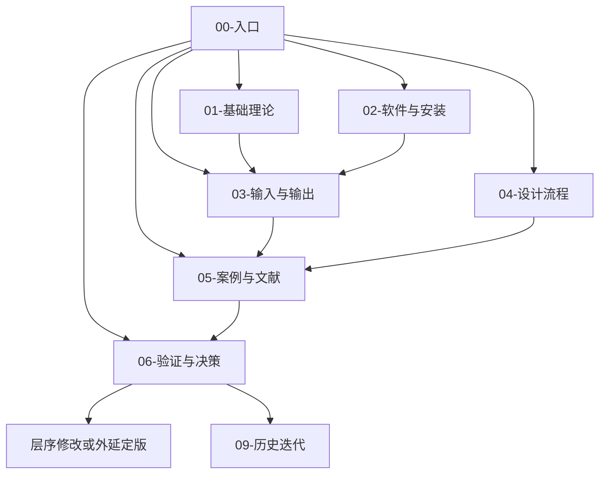

# QCL-nextnano 知识库首页

本库用于量子级联激光器设计、nextnano++/NEGF 计算、文献复现和实验外延决策。目录结构参考 `GaN-laser-pics3d` 知识库：入口、理论、软件、输入输出、流程、案例、验证决策、故障排查、术语、历史迭代相互分开。

## 当前结论

- Sun 2022 结构的 k·p 9.17 µm 主跃迁可以复现。
- 物理归一化后的 NEGF 在自由运行谱中优先给出约 10.78 µm（阈值附近）至 10.33 µm（高电流）的长波分支。
- 当前 NEGF 尚不能作为 9 µm 外延定版的独立证明。
- 尚未依据仿真修改阱垒；当前有文献实验依据的候选仍是 Sun 原始有源区，但状态是“实验参考结构”，不是“NEGF 已认证结构”。

入口：

- [[当前验证状态与结论]]
- [[Sun2022-NEGF完整验证报告]]
- [[知识库规范]]
- [[目录迁移说明]]
- [[验证决策索引]]

## 推荐阅读顺序

1. [[01-QCL工作原理与物理基础]]
2. [[07-子带间跃迁-矩阵元-增益]]
3. [[21-QCL能带设计-从入门到精通]]
4. [[03-输入文件语法入门]]
5. [[16-NEGF输入文件逐行讲解]]
6. [[Sun2022验证输入逐行注释]]
7. [[17-NEGF输出数据逐步分析]]
8. [[Sun2022-NEGF完整验证报告]]

## 知识地图

## 目录

- `00-入口`：首页、规范、当前状态、导航
- `01-基础理论`：QCL 物理、子带、能带设计谱系、约束原则
- `02-软件与安装`：nextnano 产品和命令行
- `03-输入与输出`：语法、材料、网格、NEGF 输入及输出文件
- `04-设计流程`：Checklist、实验指导、扫描流程
- `05-案例与文献`：官方示例、Fei/Liu/Sun 等复现
- `06-验证与决策`：校准、鲁棒性、波导、热学、最终判定
- `07-故障排查`：输入错误、FAQ、数值问题
- `08-术语与索引`：文献库、术语和总索引
- `09-历史迭代`：保留旧路线，避免与当前结论混用
- `_templates`：新建笔记模板
- `designs`、`scripts`、`results`：输入、分析和可复现数据

## 写作规则

详细约定见 [[知识库规范]]。最重要三条：

1. 不把仿真调参值写成材料常数；
2. 不把单点正增益写成结构可激射；
3. 不把历史迭代结论当作当前结论。
