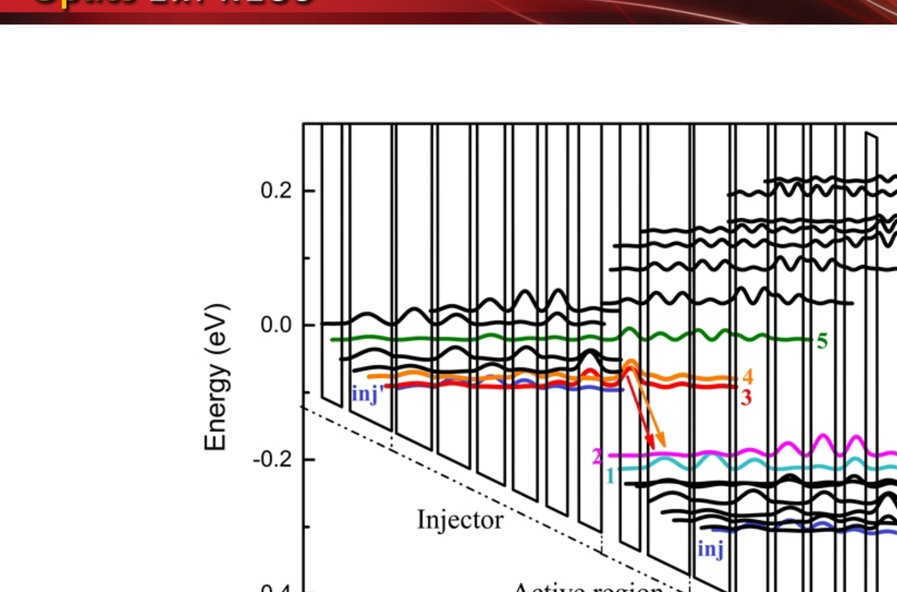
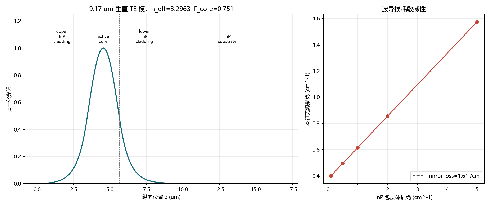

# 五级验证闸门：Sun 2022 态映射、NEGF 增益与波导

日期：2026-10-23

对象：Sun et al., *Optics Express* 30, 37272 (2022), DOI 10.1364/OE.469573
目标：逐项完成 v3 前的五个验证闸门，只有在全部通过后才允许修改层序。

## 1. 结论先行

| 闸门 | 状态 | 当前证据 |
|---|---|---|
| 独立校准有效质量、非抛物性和带阶 | 通过（参数级） | 阱 0.043 m0、垒 0.089 m0、CBO 0.773 eV；k.p 9 µm 分支成立 |
| 建立论文 E1–E5 与 NEGF/k.p 态的映射 | 基本通过 | k.p 偶极、能量差、空间位置和 E5–E4=65.85 meV 四项联合约束 |
| 标准合金散射下得到正自洽增益 | 未通过 | 独立归一化 alloy=0.06 后，自由运行峰在阈值附近为 10.78 µm、约 1.71 kA/cm²；216 mV 蓝移至 10.33 µm |
| ±0.15 nm、±0.01 组分容差 | 通过（k.p 结构层） | 阱厚 ±0.10 nm 较稳；薄垒是主要敏感项；组分 ±0.01 仍在 9 µm 窗口 |
| 波导损耗、热阻与腔面模型 | 通过（一级筛选） | Γcore≈0.751、n_eff≈3.296、镜面损耗≈1.61 cm-1、阈值材料增益≈2.97 cm-1 |

**V3 决策：暂不修改有源区层序。** 现有 NEGF 没有同时满足“9 µm 处达到阈值”与“9 µm 是全局增益峰”两项条件。用非物理地降低合金散射把波长调到 9 µm，只会产生参数拟合，不能提高外延成功率。

当前唯一可制造的基线仍是 [[43-Sun2022-9um-v2实验制造基线]] 的 Sun 原始有源区。

## 2. 论文图中的 DAU/MS 物理

论文 Fig. 1 的标注关系为：

- E1、E2：多个下激光态；
- E3、E4：双上激光态；
- E5：主要热泄漏态；
- 倾斜跃迁使 E3/E4 与 E1/E2 的空间重叠受控；
- E5 与 E4 拉开到约 66 meV，降低热激发泄漏。

## 3. 论文态与 nextnano++ 态的一一映射

计算目录：

`runs/sun2022_mocvd/band_f48/sun2022_mocvd_9um_f48/bias_00000`

使用 8-band k.p、100 个自旋态（50 个空间轨道）、48 kV/cm。下面用自旋对表示同一空间轨道。

| 论文态 | k.p 自旋对 | 能量 (meV) | 周期内位置 (nm) | 所在层 | 关键间隔 |
|---|---|---:|---:|---|---:|
| E1 | 55/56 | 2380.62 | 23.51 | W8 | E2-E1=18.86 meV |
| E2 | 59/60 | 2399.48 | 31.92 | W12 | E3-E2=116.40 meV |
| E3 | 73/74 | 2515.88 | 6.21 | B3/W4 界面 | E4-E3=59.75 meV |
| E4 | 79/80 | 2575.63 | 15.47 | W6 | E5-E4=65.85 meV |
| E5 | 87/88 | 2641.49 | 34.95 | W12 | 热泄漏入口 |

映射不是按编号猜测，而是同时使用了四项证据：

1. 允许的 E3/E4→E1/E2 四通道必须具有显著偶极矩阵元；
2. E1 与 E2 应为近邻下态，E3 与 E4 应为近邻上态；
3. E5-E4 必须接近论文给出的约 66 meV；
4. 波函数局域位置必须符合 Fig. 1 的倾斜跃迁拓扑。

该映射自然给出 E5-E4=65.85 meV，与论文的约 66 meV 相差仅 0.15 meV。

### 3.1 9.17 µm 主通道

最强 9 µm 通道为：

| 项目 | 数值 |
|---|---:|
| 态对 | E3→E1（自旋分辨 55→74 / 56→73） |
| 能量差 | 135.26 meV |
| 真空波长 | 9.17 µm |
| 偶极矩阵元 | 1.287 nm |
| 归一化振子强度 | 1.657 |
| 空间中心 | 6.21 nm ↔ 23.51 nm |

这说明主跃迁是图中的倾斜 E3→E1 通道，并非把 NEGF 输出中任意两个相邻编号直接相减。

## 4. NEGF 标准散射增益闸门

固定 IFR：Δ=0.08 nm，Λ=7 nm；固定独立材料参数。只改变 `AlloyScatteringStrength` 做模型敏感性检查，不把这些点当物理设计自由度。

| alloy strength | J (kA/cm²) | Te (K) | 135 meV 自洽增益 (cm-1) | 全局峰值 (meV) | 判定 |
|---:|---:|---:|---:|---:|---|
| 1.00 | 3.667 | 2308 | -6.93 | 120，-6.42 | 失败 |
| 1.00 + `SelfConsistentBoundary=yes` | 3.667 | 2308 | -6.93 | 120，-6.42 | 与默认逐点相同；排除边界伪峰 |
| 0.50 | 3.457 | 2434 | -3.56 | 120，-2.65 | 失败 |
| 0.25 | 3.177 | 2199 | +0.04 | 120，+1.56 | 低于阈值 |
| 0.10 | 2.892 | 1587 | +4.85 | 120，+7.47 | 9 µm 过阈值，但峰值错误 |

关键物理问题：

- 标准模型给出的电子温度高达约 1600–2400 K；
- 标准合金散射下子带寿命约 0.03–0.14 ps，显著短于论文的 1–2 ps；
- 降低散射后 9.17 µm 虽可过增益阈值，但 10.33 µm 的增益更高；
- 因而，“9 µm 有正增益”仍不足以证明装置会在 9 µm 激射。

标准散射下另做了 `SelfConsistentBoundary=yes` 对照。120–155 meV 的增益谱与默认情况逐点相同，因此当前失败不是简单的周期边界增益伪影。

这里没有把 alloy=0.10 宣称为真实材料常数。官方示例中 0.5 和 0.1 都有出现，但本结构在 0.5 时仍失败，说明不能靠“选一个官方数字”解决模型误差。

## 5. 波导、腔损耗与热学

一级模型：

- 50 stages × 45.08 nm=2.254 µm 有源芯层；
- 3.4 µm 上下 InP 包层；
- 9.17 µm；
- 假设 n_core=3.46、n_InP=3.10；
- 4 mm 腔长；
- 前腔面 R=0.29；
- HR 后腔面 R=0.95；
- TM 偏振主跃迁。

结果：

| 指标 | 数值 |
|---|---:|
| 有效折射率 n_eff | 3.296 |
| 垂直方向 Γcore | 0.751 |
| Γ_InP cladding | 0.239 |
| 镜面损耗 | 1.61 cm-1 |
| 包层体损耗 1 cm-1 时无源损耗 | 0.615 cm-1 |
| 总模态阈值增益 | 2.23 cm-1 |
| 对应材料增益阈值 | 2.97 cm-1 |

因此，低散射算例在 9.17 µm 的 +4.85 cm-1 材料增益可超过阈值，但标准模型为负，不能据此通过闸门。

热学的一级串联上限为约 15.9 K/W（不计侧向扩散）。论文 1.52 kA/cm²、10.5 V 时阈值产热约 6.7 W，对应：

| 扩散因子 | Rth (K/W) | 阈值温升 (K) |
|---:|---:|---:|
| 1.00 | 15.9 | 107 |
| 0.50 | 8.0 | 53 |
| 0.25 | 4.0 | 27 |
| 0.10 | 1.6 | 11 |

CW 评价必须使用埋入异质结、SI-InP:Fe、4 µm Au、In/diamond、epi-side-down 的真实横向热扩散；只做一维厚度串联会高估 Rth。

## 6. 为什么本轮不修改 V3 层序

修改层序必须回答“为什么这个改动改善的是器件，而不是改善模型拟合”。目前不能回答：

- 若加宽薄垒来抑制泄漏，会破坏 strain balance，并可能使波长红移；
- 若减薄阱来恢复 9 µm，会抬高上态并降低注入共振鲁棒性；
- 若通过 alloy strength 把 NEGF 增益调到正，属于隐藏模型参数拟合；
- NEGF 对已知可激射的 Sun 结构仍无法同时给出正确的峰位和足够增益，因此它暂时不能裁决 v3 的成败。

## 7. 下一轮真正的科学任务

在修改层系之前，按以下顺序做：

1. 向 nextnano 核实 `AlloyScatteringStrength` 的微观归一化；独立材料物理已给出 0.06 中心值和 0.03–0.08 范围，但正式 NEGF 定义仍待厂商确认；
2. 检查 `GainMethod=self` 在 120–155 meV 全窗内的低能伪峰，比较 `SelfConsistentBoundary=yes` 与 `noself/self` 两种方法；
3. 用位置分辨增益确认 9.17 µm 跃迁是否落在周期边界附近；
4. 若模型仍不能把 9.17 µm 设为全局峰，则冻结 v2 进入外延验证，不用 NEGF 负结果推翻已有实验证据；
5. 只有在独立校准后的 NEGF 同时复现“9 µm 峰位 + 正自洽增益 + 阈值电流量级”后，才允许提出 v3。

## 8. 可复现文件

| 内容 | 文件 |
|---|---|
| 态映射脚本 | `scripts/map_sun2022_kp.py` |
| NEGF 映射脚本 | `scripts/analyze_negf_state_mapping.py` |
| 合金敏感性输入 | `designs/sun2022_mocvd_9um_alloy010.negf`、`alloy025`、`alloy050`、`alloy100_scboundary` |
| 波导与热学脚本 | `scripts/analyze_qcl_waveguide_thermal.py` |
| 波导数值结果 | `results/qcl_waveguide_thermal/sun2022_waveguide_thermal.txt` |
| 原论文 PDF 渲染工具 | `scripts/render_pdf_pages.py` |

## 相关笔记

- [[41-文献复现-Sun2022-9um-MOCVD-DAU]]
- [[42-QCL物理约束设计原则与实验鲁棒性]]
- [[43-Sun2022-9um-v2实验制造基线]]
- [[09-QCL设计流程Checklist]]
- [[45-合金散射独立归一化与NEGF严格复现结论]]
