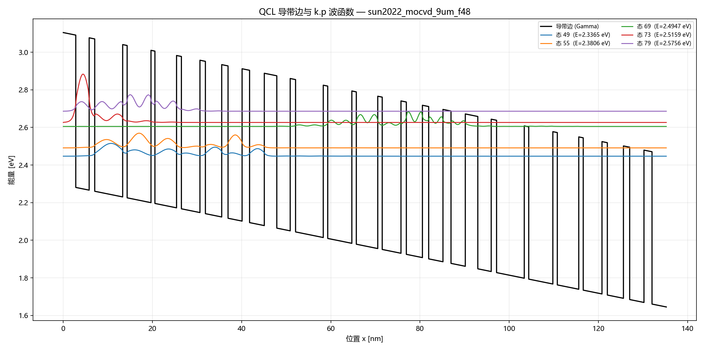
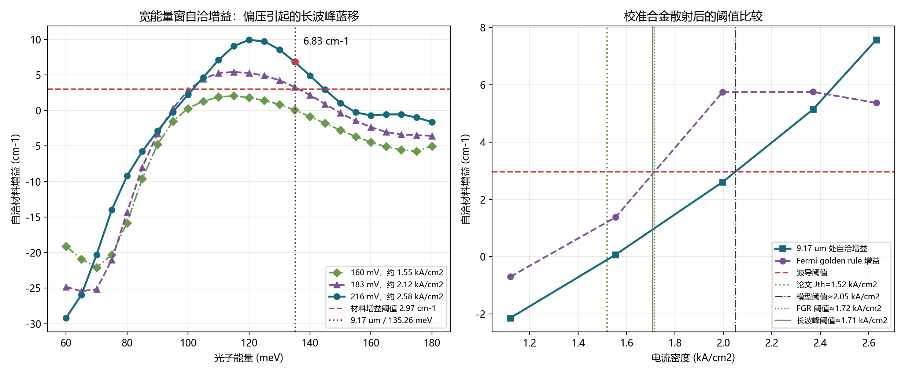
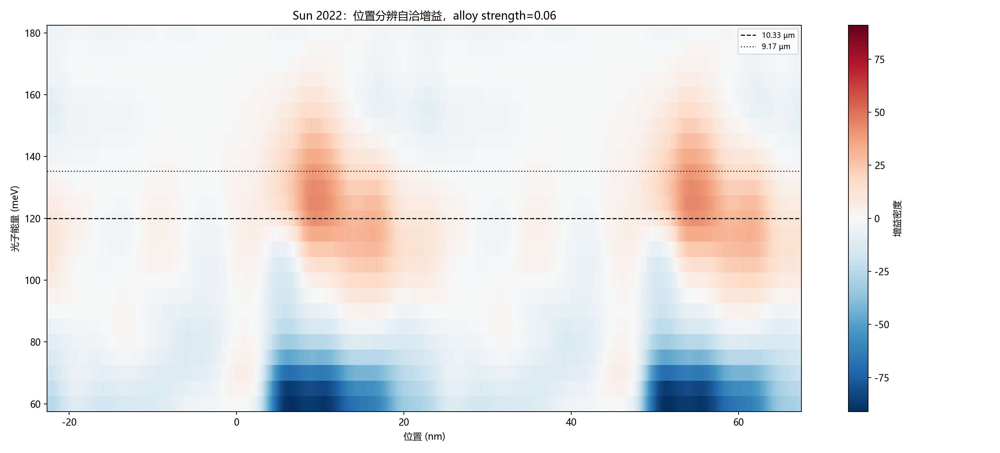
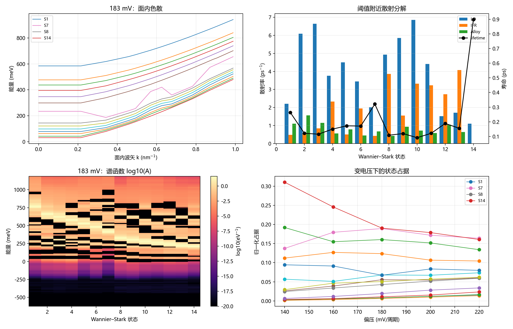
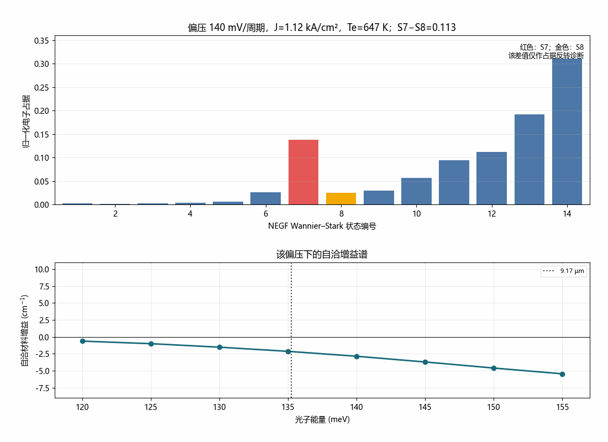

# Sun2022 NEGF 完整验证报告

## 摘要

本报告验证 Sun et al., *Optics Express* 30, 37272 (2022) 的 9 µm MOCVD DAU/MS QCL 有源区。

k·p 光学结构验证通过：在 48 kV/cm 下存在 135.26 meV / 9.17 µm、偶极 1.287 nm 的强跃迁。

物理归一化后的 NEGF 进一步给出一条稳定的长波分支：

- 阈值附近约 10.78 µm；
- 较高电流约 10.33 µm；
- 自由运行宽窗阈值约 1.71 kA/cm²；
- 强制 9.17 µm 光模的阈值约 2.05 kA/cm²；
- 论文阈值 1.52 kA/cm²。

因此当前状态为 **conflict**：9.17 µm 光学通道真实存在且增益为正，但 NEGF 的全局谱选择与论文不一致。不能把 Sun 结构标记为“NEGF 已严格认证的 9 µm 结构”。

## 1. 验证对象

| 项目 | 参数 |
|---|---|
| 材料 | In₀.₅₉₃Ga₀.₄₀₇As / Al₀.₆₃₈In₀.₃₆₂As |
| 周期 | 45.08 nm |
| 层序类型 | 16 层，B/W 交替 |
| 级联数 | 50 |
| 设计场 | 48 kV/cm |
| 每周期压降 | 216.384 mV |
| 掺杂 | 第 13–14 层，1.5×10¹⁷ cm⁻³ |
| 片密度 | 6.855×10¹⁰ cm⁻² |

层序文件和 CSV：

- `designs/sun2022_mocvd_9um_f48.nnp`
- `designs/sun2022_mocvd_9um_f48_layers.csv`

## 2. 输入模型

完整注释输入：

- `designs/sun2022_mocvd_validation_annotated.negf`
- [[Sun2022验证输入逐行注释]]

关键设置：

| 项目 | 设置 | 依据 |
|---|---|---|
| CBO | 0.773 eV | 独立近同组分文献 |
| m* well/barrier | 0.043/0.089 m0 | 独立材料数据 |
| 非抛物性 | axial + in-plane | nextnano 3-band |
| IFR | 0.08 nm，7 nm | MOCVD 薄垒基线 |
| 合金散射 | 0.06 | 等效 dV≈0.59/0.66 eV |
| e-e scattering | yes | 高密度 QCL |
| acoustic phonon | no | 当前基线限制，需敏感性检查 |
| 相干长度 | 1 period | 周期 QCL 基线 |

## 3. 光学态映射

nextnano++ 8-band k·p 在 48 kV/cm 下给出：

| 论文态 | k·p 自旋对 | 能量 (meV) | 周期内位置 (nm) |
|---|---|---:|---:|
| E1 | 55/56 | 2380.62 | 23.51 |
| E2 | 59/60 | 2399.48 | 31.92 |
| E3 | 73/74 | 2515.88 | 6.21 |
| E4 | 79/80 | 2575.63 | 15.47 |
| E5 | 87/88 | 2641.49 | 34.95 |

关键通道：

| 通道 | ΔE | 波长 | 偶极 |
|---|---:|---:|---:|
| E3→E1 | 135.26 meV | 9.17 µm | 1.287 nm |
| E3→E2 | 116.40 meV | 10.66 µm | 0.846 nm |
| E4→E2 | 176.16 meV | 7.04 µm | 1.465 nm |

E5−E4=65.85 meV，与论文约 66 meV 相符。



### 3.1 NEGF 长波分支的候选态对

直接使用 NEGF 的 `Energy_Eigenstates.dat`、`Dipoles.txt` 和占据数，可在 183 mV 找到与 10.4–11.3 µm 同量级、且上态占据较高的候选通道：

| 候选态对 | ΔE | 波长 | \|z\| | 上/下态占据 |
|---|---:|---:|---:|---:|
| 4→20 / 18→34 | 109.92 meV | 11.28 µm | 0.106 nm | 0.0453 / 0.0118 |
| 16→32 | 117.58 meV | 10.55 µm | 0.086 nm | 0.0118 / 0.0072 |
| 3→19 | 118.18 meV | 10.49 µm | 0.047 nm | 0.0283 / 0.0089 |
| 8→26 | 119.05 meV | 10.42 µm | 0.010 nm | 0.121 / 0.045 |

216 mV 时，4→42 给出 127.47 meV / 9.72 µm、\|z\|=1.142 nm，且上/下占据为 0.166/0.020。它属于跨周期 Wannier–Stark 态耦合，不能简单写成论文图中的 E3→E1。

因此长波宽峰更像多条周期内/周期间通道的叠加，而不是单一跃迁。transition-resolved 输出的索引仍需向软件方确认后才能逐个按态编号解释。

## 4. 合金散射独立归一化

`AlloyScatteringTerm.dat`：

| 层 | term (eV²) | sqrt(term) |
|---|---:|---:|
| InGaAs well | 5.836815 | 2.416 eV |
| AlInAs barrier | 7.337601 | 2.709 eV |

`strength=1.0` 对应约 2.42–2.71 eV，明显高于独立 InGaAs/InAlAs 合金势 0.44–0.70 eV。

`strength=0.06` 对应：

```text
well:    0.592 eV
barrier: 0.664 eV
```

落在 nextnano 推荐约 0.6 eV 和独立实验范围内。因此后续采用 0.06，而不是 1.0。

散射率随 strength 严格线性：0.5、0.25、0.1 分别给出 0.5、0.25、0.1 倍散射率。

## 5. 偏压扫描与阈值

| 偏压 (mV/period) | J (kA/cm²) | Te (K) | gain@9.17 µm |
|---:|---:|---:|---:|
| 140 | 1.121 | 647 | −2.13 |
| 160 | 1.555 | 826 | +0.07 |
| 180 | 1.997 | 1027 | +2.60 |
| 200 | 2.371 | 1261 | +5.15 |
| 220 | 2.631 | 1528 | +7.57 |

波导模型的材料增益阈值约 2.97 cm⁻¹。

- 固定 9.17 µm：阈值约 2.05 kA/cm²；
- FGR 宽窗峰：阈值约 1.72 kA/cm²；
- 自洽宽窗长波峰：阈值约 1.71 kA/cm²；
- 论文：1.52 kA/cm²。

## 6. 宽窗增益和长波优先

### 6.1 216 mV

| 光子能量 | 波长 | 自洽增益 |
|---:|---:|---:|
| 110 meV | 11.27 µm | 7.09 cm⁻¹ |
| 120 meV | 10.33 µm | 9.93 cm⁻¹ |
| 130 meV | 9.54 µm | 8.56 cm⁻¹ |
| 135.26 meV | 9.17 µm | 6.83 cm⁻¹ |
| 140 meV | 8.86 µm | 4.89 cm⁻¹ |

### 6.2 阈值附近

| 偏压 | 宽窗峰 | 峰值 |
|---|---:|---:|
| 160 mV | 10.78 µm | 2.05 cm⁻¹ |
| 183 mV | 10.78 µm | 5.41 cm⁻¹ |
| 216 mV | 10.33 µm | 9.93 cm⁻¹ |

电流增大时峰位蓝移，而不是稳定在 9.17 µm。



若把当前模型预测当作设计输入，10.3–10.8 µm 波导筛选得到：

| 波长 | n_eff | Γcore | 材料阈值增益 | 一级 DFB Bragg 周期 |
|---:|---:|---:|---:|---:|
| 10.33 µm | 3.277 | 0.706 | 3.19 cm⁻¹ | 1.576 µm |
| 10.78 µm | 3.270 | 0.689 | 3.28 cm⁻¹ | 1.648 µm |

这组数只用于长波模式选择的初期设计，不能反过来证明真实器件一定在长波激射。

## 7. 位置分辨增益

| 光子能量 | 最大增益位置 | 层 | 正增益质心 |
|---:|---:|---|---:|
| 120 meV | 9.52 nm | W4 | 32.14 nm |
| 130 meV | 9.32 nm | W4 | 32.60 nm |
| 135.26 meV | 9.12 nm | W4 | 32.63 nm |
| 140 meV | 9.12 nm | W4 | 32.19 nm |

长波和 9 µm 分支都来自有源区 W4 附近并逐周期重复，因此 10.3 µm 主峰不是周期边界造成的。



## 8. 高级 NEGF 输出

分析文件包括：

- 面内色散 `InplaneDispersion.dat`；
- 状态寿命 `Lifetimes.dat`；
- LO / IFR / alloy `ScatteringRate_mechanisms.dat`；
- 谱函数 `SpectralFunctions.dat`；
- 密度矩阵；
- 位置和能量分辨增益；
- FGR 与自洽线性响应。

各项功能的可用状态见 [[NEGF高级功能与输出清单]]。



密度矩阵输出显示，每个周期的对角占据重复，且非对角相干项不可忽略。最大相干项包括：

| 状态对 | Re(ρ) | Im(ρ) | \|ρ\| |
|---|---:|---:|---:|
| 13–14 | +5.208×10⁻³ | +3.047×10⁻³ | 6.034×10⁻³ |
| 12–21 | +4.013×10⁻⁴ | +4.212×10⁻³ | 4.231×10⁻³ |
| 11–12 | +1.141×10⁻³ | +2.837×10⁻³ | 3.057×10⁻³ |

这说明只用“对角 population”做速率方程会漏掉周期间相干耦合；这也是必须使用 NEGF 自洽增益的一部分。

密度矩阵详细输出：

`results/qcl_validation/sun2022_density_matrix_183mV.txt`

### 粒子数反转动画



动画显示：

- 状态 S7 在 140–180 mV 快速积累；
- S8 在更高偏压继续积累；
- S7−S8 的占据差在偏压升高后趋于饱和/下降；
- 同时增益谱整体红移到低能、高偏压后蓝移。

S7−S8 只能作为占据反转诊断，不能未经跃迁基组确认就声称它就是唯一的激光上下能级。

## 8.1 模型开关控制实验

在 183 mV 宽窗基线上做了两个单变量对照：

| 变体 | 引擎行为 | 结果 |
|---|---|---|
| acoustic phonon = yes | 当前版本提示 “not implemented” / “set to zero” | 与基线逐行相同 |
| `SelfConsistentBoundary=yes` | 正常计算 | 与基线逐行相同 |

因此：

- 不能把 acoustic phonon 当作已经计入；
- 至少在本周期边界的放置方式下，长波主峰不是自洽边界实现造成的。

## 9. 仍存在的模型问题

1. NEGF 阈值附近有效电子温度约 1.0×10³ K，明显偏热；
2. 子带寿命约 0.09–0.32 ps，远短于论文 1–2 ps；
3. 状态分解输出的 transition index 与直接能量差目前不能逐对解释，必须向 nextnano 确认该文件的 state ordering；
4. acoustic phonon scattering 在当前基线关闭；
5. NEGF 只能证明该模型预测 10.3–10.8 µm，不能证明真实器件一定如此。

## 10. 外延决策

不建议依据当前 NEGF 直接制作一个“必须在 9 µm 激射”的器件。

选择如下：

- 如果目标是复现论文：优先获取该论文原片的 EL、阈值和 HR 腔数据，或请 nextnano 复核本案例；
- 如果目标是使用当前结构：按 10.3–10.8 µm 设计外腔/DFB，不得默认 9 µm；
- 如果目标严格为 9 µm：重新设计有源区，不能只微调阱垒来抵消模型红移；
- v3 层序修改仍未获授权，闸门仍未全部通过。

## 11. 变偏压 LDOS、I–V 与粒子数翻转补充

0–260 mV/period 的完整偏压动画、状态占据和阈值分析已经整理到：

- [[Sun2022-变偏压LDOS-IV与激射分析教程]]
- [[Sun2022-10p33um第二轮设计与两轮比较]]

新增结果：

- 9 µm 线性材料增益阈值约 183.35 mV/period、2.06 kA/cm²；
- 自由运行峰在 140–220 mV 仍为 10.33 µm，240–260 mV 移到约
  9.92 µm；
- 固定 9.17 µm 光模时，216.384 mV 接近阈值，220–240 mV 出现
  快速增加的内部光功率；
- 外推到固定光模的动态过阈值区约 2.58–2.64 kA/cm²。

按自洽长波峰改做 10.33 µm 固定光模后：

| 偏压 | 9.17 µm 净内部功率 | 10.33 µm 净内部功率 |
|---:|---:|---:|
| 216.384 mV | 3.09 kW/cm³ | 5.354 MW/cm³ |
| 220 mV | 96.9 kW/cm³ | 7.288 MW/cm³ |
| 240 mV | 3.811 MW/cm³ | 9.868 MW/cm³ |

同一结构、同一损耗和同一光限制因子下，10.33 µm 模式的动态阈值更低、
输出更强。详细方法见 [[Sun2022-10p33um第二轮设计与两轮比较]]。

## 相关文件

- [[Sun2022验证输入逐行注释]]
- [[Sun2022-变偏压LDOS-IV与激射分析教程]]
- [[45-合金散射独立归一化与NEGF严格复现结论]]
- [[44-五级验证闸门-Sun2022态映射增益与波导]]
- [[43-Sun2022-9um-v2实验制造基线]]
